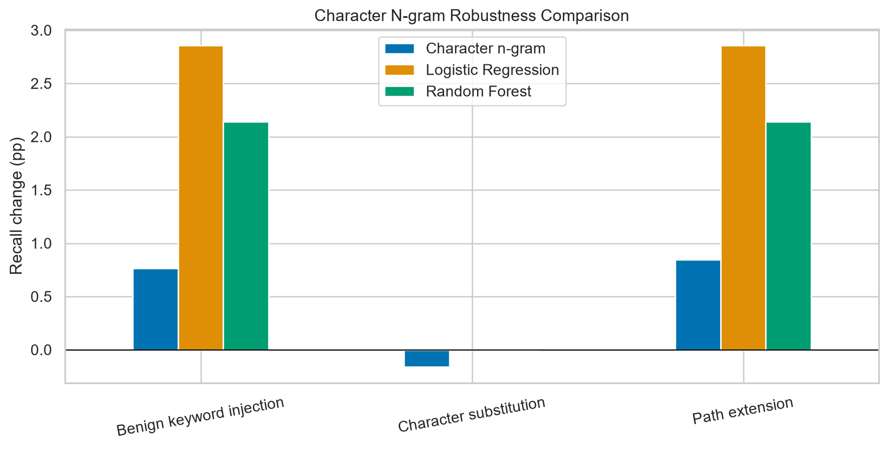

# Phishing URL Detection: Machine Learning and Adversarial Robustness Analysis

## Overview and research motivation

This project compares two lexical baselines with a character n-gram classifier for offline phishing URL detection. It asks how well each model recognizes phishing on held-out registered domains and how its recall changes under fixed edits to the URL path. Domain separation matters because a random URL-level split can place closely related URLs on both sides of the evaluation.

## Dataset and preparation

The source is [PhiUSIIL Phishing URL (Website), UCI dataset 967](https://archive.ics.uci.edu/dataset/967/phiusiil+phishing+url+dataset), contributed by Arvind Prasad and Shalini Chandra and licensed under CC BY 4.0. UCI encodes phishing as `0` and legitimate URLs as `1`. The classifier uses the original `URL` field and the target. Precomputed URL statistics and webpage-derived fields are excluded from training.

The default loader uses `ucimlrepo` and caches the URL and label columns locally. The reported run loaded the official UCI ZIP while the direct CSV transfer was slow. The loader records the source schema and missing values, removes rows with missing URL or label, strips outer whitespace, rejects malformed HTTP(S) inputs, removes all rows with contradictory labels for the same URL, then deduplicates exact cleaned strings. The source schema, removal counts, class counts and cleaned URL/label fingerprint are in [the dataset summary](results/dataset_summary.json).

## Feature engineering

The lexical models use 19 URL-string features. These cover URL, hostname, path and query lengths; subdomain depth; parsed IP hostname; HTTPS; the presence of `@` and a fragment; counts of dots, hyphens, underscores, digits, special characters, slashes and percent signs; query parameter count; Shannon character entropy; and a keyword indicator for terms such as `login`, `verify` and `account`. Keywords are model inputs. The source dataset supplies the labels.

## Leakage-safe data splitting

The grouping key is the registered domain from the bundled Public Suffix List snapshot in the pinned `tldextract` package. The extractor uses the public section of the snapshot and performs no network lookups. Hostnames are normalized to lowercase IDNA ASCII and have any trailing DNS root dot removed. IP literals are grouped by normalized address, and unresolved suffixes share one group.

With seed 42, the experiment considers 32 group holdouts and selects the one minimizing the sum of absolute deviations from the target 20% test row share and the overall phishing fraction. Both partitions must contain both labels. The program checks domain overlap explicitly. All three models use the same holdout, and the transformations that learn parameters are fit on the training partition.

## Machine learning models

| Model | Inputs and training |
|---|---|
| Logistic Regression | Standardized lexical features in a scikit-learn pipeline |
| Random Forest | Lexical features, 100 trees and a minimum of three samples per leaf |
| Character n-gram | Character TF-IDF over 3–5 grams, at most 40,000 features and minimum document frequency of three, followed by logistic regression in a pipeline |

## Adversarial perturbation methodology

The program takes the phishing URLs from the fixed test partition and applies three independent, deterministic path edits. Character substitution changes the first eligible lowercase `l`, `o` or `i` outside percent escapes to a visually similar digit. Path extension appends a fixed nested path. Benign keyword injection appends `about`, `help` and `contact` as path segments. Each edit preserves the URL text outside the path. All edits are applied to strings without resolving URLs, and the models stay fixed.

For each method, the comparison uses the same successfully edited rows before and after the edit. The original recall for an eligible subset may differ from full-holdout recall. The program records invalid results and rows with no eligible edit, saves local URL pairs under `data/`, and reports the signed difference as edited minus original recall in percentage points.

## Experimental results

See [clean holdout metrics](results/metrics.csv) and [paired robustness results](results/attack_results.csv).

UCI returned 235,795 rows, comprising 100,945 phishing URLs and 134,850 legitimate URLs. Cleaning removed 425 duplicate URL rows. There were zero missing URL or label rows, invalid URLs or rows with conflicting labels. The 235,370 retained rows split into 189,124 training URLs and 46,246 test URLs. Phishing prevalence was 42.90% in training and 41.91% in testing. There were zero shared domain groups.

### Model comparison

| Model | Accuracy | Precision | Phishing recall | F1 | ROC-AUC |
|---|---:|---:|---:|---:|---:|
| Logistic Regression | 0.9880 | 0.9998 | 0.9714 | 0.9854 | 0.9952 |
| Random Forest | 0.9909 | 0.9997 | 0.9786 | 0.9890 | 0.9968 |
| Character n-gram | 0.9957 | 1.0000 | 0.9896 | 0.9948 | 0.9988 |

Character n-grams achieved the highest clean recall and F1. They missed 201 phishing URLs compared with 415 for Random Forest and 554 for lexical Logistic Regression. Character TF-IDF preserves short sequence patterns that aggregate counts discard. The experiment did not isolate which patterns accounted for the gain.

### Robustness analysis

| Perturbation | Model | Original recall | Perturbed recall | Recall change |
|---|---|---:|---:|---:|
| Character substitution | Logistic Regression | 100.00% | 100.00% | +0.00 pp |
| Character substitution | Random Forest | 100.00% | 100.00% | +0.00 pp |
| Character substitution | Character n-gram | 99.49% | 99.33% | -0.16 pp |
| Path extension | Logistic Regression | 97.14% | 100.00% | +2.86 pp |
| Path extension | Random Forest | 97.86% | 100.00% | +2.14 pp |
| Path extension | Character n-gram | 98.96% | 99.81% | +0.85 pp |
| Benign keyword injection | Logistic Regression | 97.14% | 100.00% | +2.86 pp |
| Benign keyword injection | Random Forest | 97.86% | 100.00% | +2.14 pp |
| Benign keyword injection | Character n-gram | 98.96% | 99.73% | +0.76 pp |

Character substitution covered 4,328 of 19,382 phishing test URLs. The remaining 15,054 had no eligible character. Both append methods covered all 19,382 URLs, and no edits produced invalid URLs. Character substitution slightly reduced n-gram recall on its eligible subset. The two append methods raised recall for every model, with both lexical baselines reaching 100% on those edited phishing samples.

A non-root path occurred in 5,213 of 19,382 phishing test URLs and in zero of 26,864 legitimate test URLs. Appending a path segment adds a cue associated with phishing in this split, which may help explain the recall gains. Character substitution applies to a selected subset of phishing URLs with paths. Since only phishing URLs were edited, the results provide no estimate of how these edits change false positives.

## Visualizations

| Figure | Focus |
|---|---|
| [Dataset class distribution](figures/class_distribution.png) | Cleaned class counts |
| [Baseline model comparison](figures/baseline_comparison.png) | Accuracy, precision, recall, F1 and ROC-AUC |
| [Recall before and after edits](figures/recall_before_after.png) | Paired lexical baseline recall |
| [Character n-gram robustness](figures/ngram_robustness.png) | Signed recall change for all models |
| [Confusion matrices](figures/confusion_matrix.png) | Clean-holdout errors by class |



## Installation and execution

From the repository root in a VS Code PowerShell terminal, use Python 3.13.7 and run

```powershell
py -3.13 -m venv .venv
.\.venv\Scripts\python.exe -m pip install -r requirements.txt
.\.venv\Scripts\python.exe main.py
.\.venv\Scripts\python.exe -m pytest -q
```

In VS Code, select `.venv\Scripts\python.exe` as the Python interpreter. The first run requires access to UCI to download the dataset. To download it separately, run `.\.venv\Scripts\python.exe main.py --download-only`. If the API CSV transfer is slow, download the ZIP from the UCI dataset page and pass its local path with `--uci-archive`. Subsequent runs can use the local cache and regenerate the aggregate outputs in `results/` and `figures/`.

## Reproducibility

The dependency lock reflects the tested Windows environment. The split and model seeds are fixed at 42, the suffix snapshot ships with the pinned package, and the path edits depend only on the input string. Use the input fingerprint in the dataset summary to verify that a repeat run uses the same cleaned source snapshot. A repeat run from the local cache produced byte-identical metric and robustness CSVs, and the 18 pytest checks passed.

## Limitations and future work

The experiment measures one holdout from one dataset. Registry-domain separation reduces direct domain overlap, while cross-domain campaign templates, collection artifacts and temporal drift may still influence the scores. Each edit has a fixed structure and may alter the resource a URL would identify. The evaluation measures classification stability for those strings. Future work could use time-separated and cross-source datasets, compare a combined lexical and n-gram model, and add uncertainty estimates that account for domain grouping.

## Ethical considerations

This is offline machine learning research. It performs no phishing attacks, scanning, DNS lookups or requests to dataset URLs and does not verify whether edits retain any live functionality. The observed changes measure classifier behavior under the selected perturbations. The models are research prototypes and have not been validated for production security decisions. The GitHub-ready files contain aggregate metrics and figures. Raw URLs and paired variants are excluded from version control.
